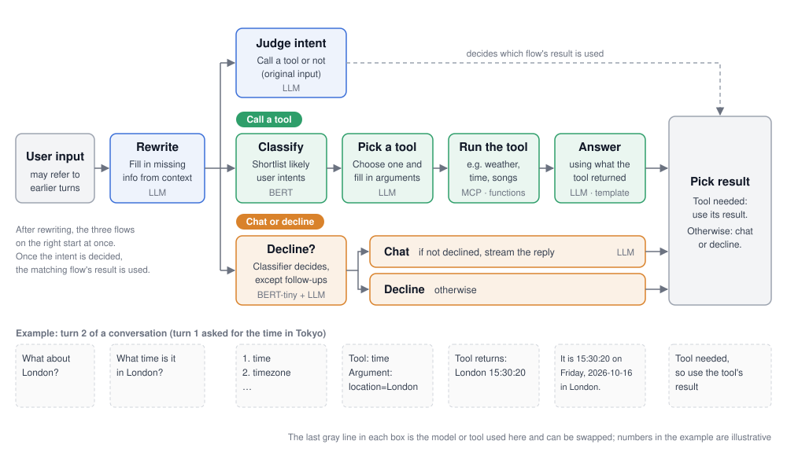

<p align="right"><a href="README.md">中文</a> | English</p>

# an-agent-demo

An agent that can call tools and chat, for use in scenarios such as smart homes.



## Workflow

**On user input** (`start.py`, simplified)

```python
ori_query = query                                            # user input
query = request_rewrite(ori_query, last_answer, sender_id)   # fill in missing or referenced info from earlier turns

# Several flows start at once; once the intent is decided, the matching flow's result is used
arbitration = pool.submit(request_arbitration, ori_query, sender_id)  # judge intent
nlu         = pool.submit(request_nlu, query, trace_id, enable_dm)    # call a tool
reject      = pool.submit(request_reject, query, trace_id)            # decline or not
correlation = pool.submit(request_correlation, ori_query, sender_id)  # related to the previous turn or not
chat        = pool.submit(request_chat, ori_query, sender_id)         # chat

if arbitration.result() == "task":
    send(nlu.result())                                       # answer using what the tool returned
elif reject.result() == 1 or correlation.result() == "是":   # not declined, or related to the previous turn ("是" = yes)
    stream(chat.result())                                    # stream the chat reply as it is generated
else:
    send_reject()                                            # decline
```

**When a tool is needed** (`function_call/chatnlu_infer.py`, simplified)

```python
top5, scores = intent_recall(query)                        # a classifier shortlists the most likely user intents
candidates = top5[:1] if max(scores) > 0.98 else top5      # if the top one clears the threshold, use it directly
tool_call = send_messages(messages, tools_of(candidates))  # the LLM picks one of these intents' tools and fills in the arguments
func_name, slots = parse(tool_call)

# run the tool and answer using what it returned
tool_response, nlg = await DMFactory.get(func_name)(func_name, query, slots)
```

- **Intent and reject classifiers**: list the intents and their tools in `config/class.txt`, then retrain both models on matching data (in `train/data/intent/` and `train/data/reject/`)
- **Tools**: define tools and their parameters in `function_call/function.py` (`scripts/generate_functions.py` can generate them in bulk from intent descriptions), and write the code that runs them in `function_call/dm/`. A tool can be an external service connected through MCP (see `mcp_core/`)
- **Prompts**: in `prompts.py`

## Setup

Requires Redis (stores multi-turn context) and an OpenAI-compatible LLM API that supports function calling.

```bash
pip install -r requirements.txt
cp config/config.example.ini config/config.ini   # fill in API_KEY, BASE_URL, OPENWEATHER_API_KEY (for weather queries)
# replace YOUR_MODEL_DEPLOYMENT_ID in client/ and function_call/chatnlu_infer.py with your model name

redis-server &
bash server.sh                                   # start all services
ENTRY_URL=http://127.0.0.1:8080 python dialog.py # chat in the terminal
```

## Training and evaluation

### Training

Two classifiers are trained; the LLM handles the rest:

- **Intent classification**: `train/train_intent.py`; example data: e.g. CLINC150, a public English intent dataset
- **Decline or not**: `train/run.py --model bert_tiny --data reject`

### Evaluation

- Accuracy of intent classification and declining: `test/intent_client.py`, `test/reject_client.py`
- Accuracy of intents and arguments (e.g. location, time): `test/nlu_client.py`
- Overall multi-turn performance: `test.py` runs multi-turn conversations; `e2e_score.py` computes accuracy after manual labeling
- Concurrency load tests for each service: `test/*_benchmark.py`
