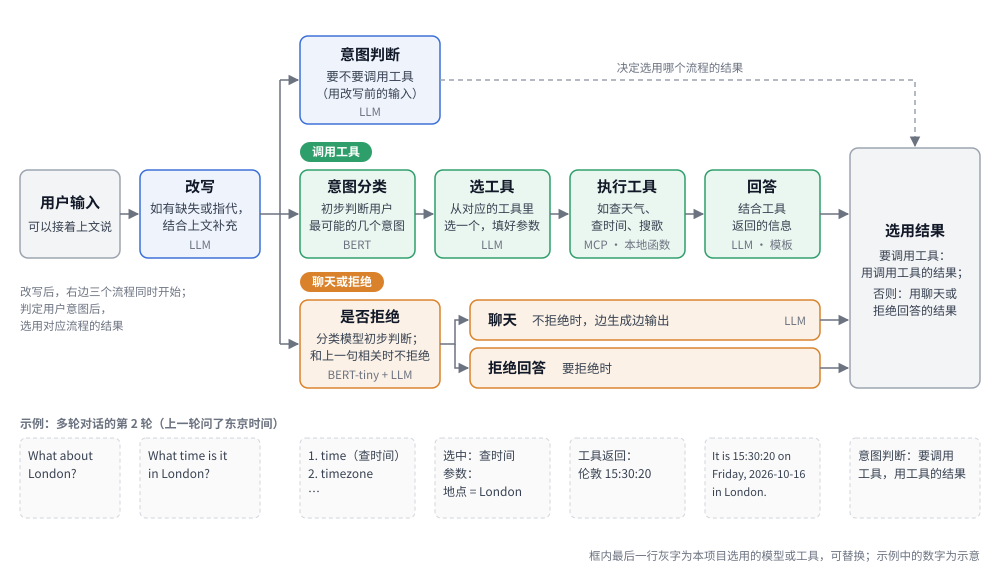

<p align="right">中文 | <a href="README.en.md">English</a></p>

# an-agent-demo

一个能调用工具和聊天的 agent，可用于智能家居等场景。



## 流程

**收到用户输入后**（`start.py`，简化）

```python
ori_query = query                                            # 用户输入
query = request_rewrite(ori_query, last_answer, sender_id)   # 如存在缺失信息、指代信息等情况，结合上文补充

# 几个流程同时开始，判定用户意图后，选用对应流程的结果
arbitration = pool.submit(request_arbitration, ori_query, sender_id)  # 意图判断
nlu         = pool.submit(request_nlu, query, trace_id, enable_dm)    # 调用工具
reject      = pool.submit(request_reject, query, trace_id)            # 是否要拒绝回答
correlation = pool.submit(request_correlation, ori_query, sender_id)  # 和上一句是否相关
chat        = pool.submit(request_chat, ori_query, sender_id)         # 聊天

if arbitration.result() == "task":
    send(nlu.result())                                       # 结合调用工具返回的信息回答
elif reject.result() == 1 or correlation.result() == "是":   # 不拒绝，或和上一句相关
    stream(chat.result())                                    # 用聊天的结果，边生成边输出
else:
    send_reject()                                            # 拒绝回答
```

**需要调用工具时**（`function_call/chatnlu_infer.py`，简化）

```python
top5, scores = intent_recall(query)                        # 分类模型初步判断最有可能的几个用户意图
candidates = top5[:1] if max(scores) > 0.98 else top5      # 第一名可能性高过设定阈值时，直接采用
tool_call = send_messages(messages, tools_of(candidates))  # 大模型从这些意图对应的工具里选一个，并填好参数
func_name, slots = parse(tool_call)

# 执行工具，结合调用工具返回的信息回答
tool_response, nlg = await DMFactory.get(func_name)(func_name, query, slots)
```

- **意图分类和拒识模型**：在 `config/class.txt` 列出意图及对应的工具，用相应数据（放在 `train/data/intent/`、`train/data/reject/`）重新训练意图分类模型和拒识模型两个模型
- **工具**：在 `function_call/function.py` 定义工具和参数（`scripts/generate_functions.py` 可根据意图描述批量生成），在 `function_call/dm/` 写执行工具的代码。工具可以是通过 MCP 接入的外部服务（见 `mcp_core/`）
- **提示词**：在 `prompts.py`

## 安装与运行

需要 Redis（保存多轮对话的上下文），和支持工具调用（function calling）的 OpenAI 兼容大模型接口。

```bash
pip install -r requirements.txt
cp config/config.example.ini config/config.ini   # 填写 API_KEY、BASE_URL、OPENWEATHER_API_KEY（如需要查询天气）
# 把 client/ 和 function_call/chatnlu_infer.py 中的 YOUR_MODEL_DEPLOYMENT_ID 换成实际模型名

redis-server &
bash server.sh                                   # 启动各个服务
ENTRY_URL=http://127.0.0.1:8080 python dialog.py # 在命令行里对话
```

## 训练与评估

### 训练

训练两个分类模型，其余环节由大模型完成：

- **意图分类**：`train/train_intent.py`，示例数据：如公开的英文意图数据集 CLINC150
- **是否拒绝**：`train/run.py --model bert_tiny --data reject`

### 评估

- 意图分类、是否拒绝的准确率：`test/intent_client.py`、`test/reject_client.py`
- 意图和参数（如地点、时间）的准确率：`test/nlu_client.py`
- 多轮对话的整体效果：`test.py` 测试多轮对话表现，`e2e_score.py` 人工标注对错后计算准确率
- 各服务的并发压测：`test/*_benchmark.py`
